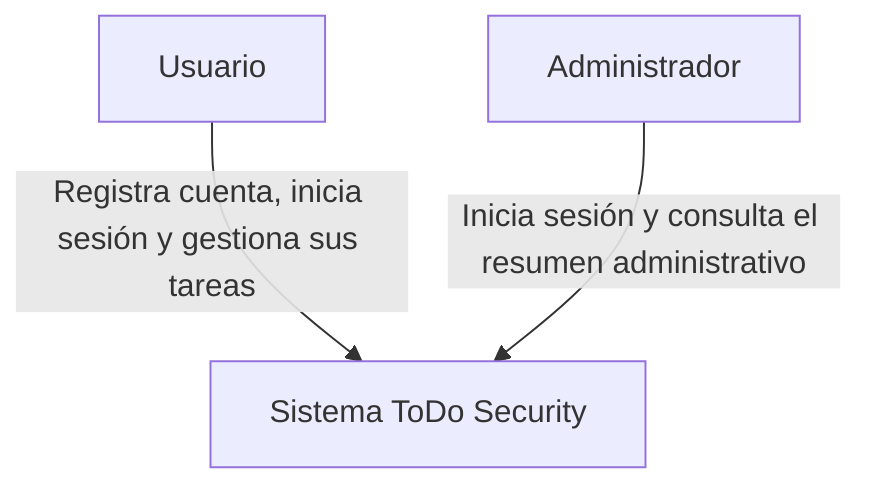
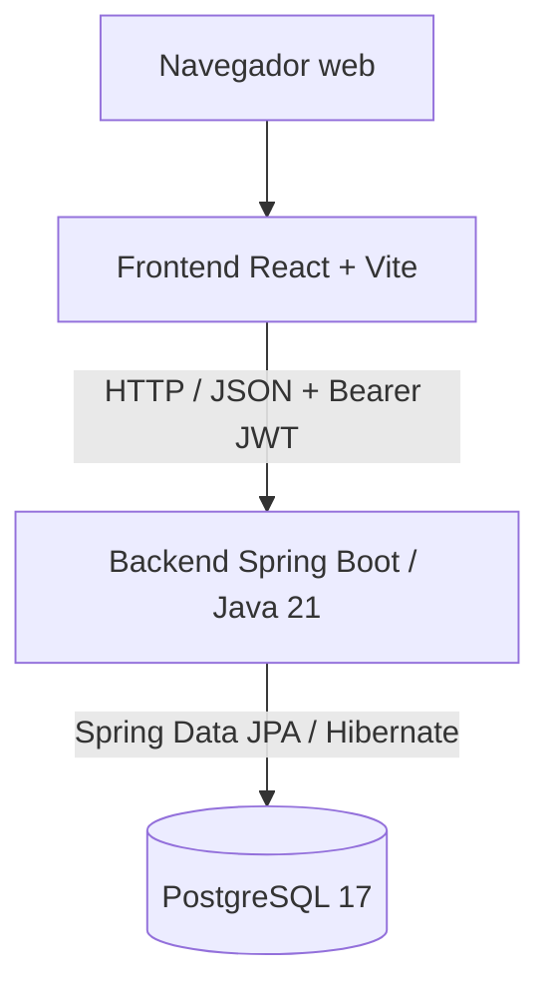
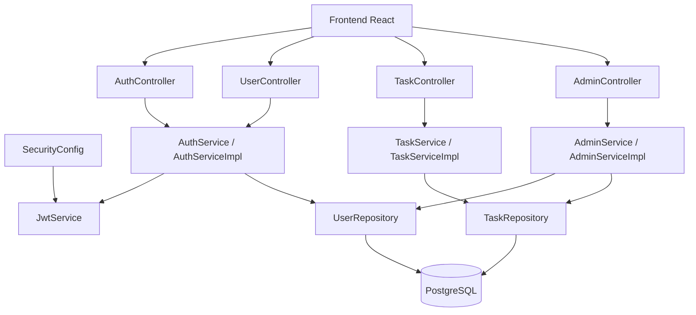

# Arquitectura C4 — ToDo Security

## Nivel 1. Contexto del sistema

El sistema permite a los usuarios autenticarse y administrar sus propias tareas. Los administradores tienen acceso adicional al resumen administrativo, sujeto a autorización.

## Nivel 2. Contenedores

El frontend consume la API REST del backend. El backend valida la autenticación y autorización antes de ejecutar operaciones protegidas y persiste la información en PostgreSQL.

## Nivel 3. Componentes del backend

`SecurityConfig` establece las reglas de acceso de la API y utiliza el servicio JWT para apoyar la autenticación. Los controladores delegan la lógica de negocio en los servicios, que acceden a los datos mediante repositorios.

## Consideraciones de seguridad

- Las rutas de registro e inicio de sesión son públicas.
- Las demás rutas protegidas requieren un JWT válido.
- Los usuarios tienen el rol `USER` por defecto; las operaciones administrativas requieren `ADMIN`.
- Las contraseñas se almacenan usando BCrypt, no en texto plano.
- Las tareas deben estar asociadas a su propietario.
- La autenticación es sin estado en el servidor mediante tokens JWT.
